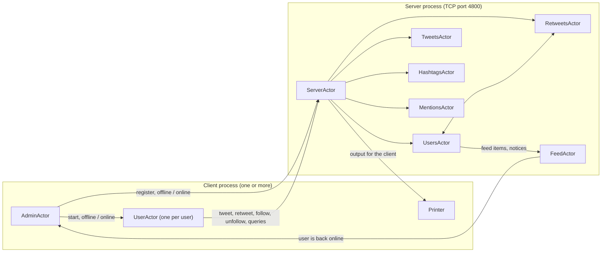

# Twitter Clone

A Twitter-like engine and a load simulator written in F# with [Akka.NET](https://getakka.net/) actors. The engine runs in a server process. Client processes simulate users who register, tweet, retweet, follow and unfollow each other, search by hashtag and mention, and go offline and come back. The server and the clients are separate actor systems that talk over TCP with Akka.Remote, so they can run on different machines.

Everything is in one script, [`TwitterClone.fsx`](TwitterClone.fsx), run with `dotnet fsi`.

This is Part I of Project 4 for COP 5615 Distributed Operating System Principles at the University of Florida (Fall 2021, Dr. Alin Dobra). Part II adds a web interface built with Suave: [twitter-clone-part2](https://github.com/michaelperez023/twitter-clone-part2).

Written by [Michael Perez](https://github.com/michaelperez023) and [Blas Kojusner](https://github.com/bkojusner).

## What it does

The server:

- registers clients and their users;
- handles follows and unfollows. Each user has a follower cap, and a follow is refused when the target has reached its cap or is already followed;
- accepts tweets, which may contain `#hashtags` and `@mentions`, and retweets of an item from the user's own feed;
- adds each tweet or retweet to the feed of every follower of its author, and shows it right away to the followers who are online;
- shows a new tweet right away to the online users it mentions;
- shows a user the 10 most recent items in their feed when they come back online;
- answers queries for the 10 most recent tweets with a given hashtag or that mention a given user;
- keeps the 100 most recent tweets of each feed, hashtag and user's mentions, and drops older ones;
- prints the number of client requests and requests per second every 3 seconds.

Each client simulates `users_per_client` users:

- It registers one user every 0.05 s, each with its own actor.
- Each user has a rank r from 1 to N, where N is the number of users per client. Ranks are assigned by shuffling the user numbers with the client ID as the seed, so every client can tell which user holds a given rank on any client. The user can have at most (N - 1) / r followers and tweets every b × r milliseconds, where b = max(10, N / 100).
- Each tweet is plain, has a hashtag, has a mention, has both, or is a retweet, chosen at random with equal odds.
- Every 0.2 s each online user also does one of the following at random: follow someone, unfollow a random followee, query a random hashtag, or query a random user's mentions. To choose whom to follow, it picks a random client and then a rank on that client with probability proportional to 1 / r.
- Every 10 s, 10% of the registered users go offline and the previous batch comes back online.
- It prints everything the server sends back to its users.

Because follows favor top-ranked users, the number of followers falls off roughly as 1 / rank (Zipf's law), and the users with the most followers also tweet the most. Follows and unfollows are equally likely, so the follow graph stays small: about 3.7 follow links per user in the 2 × 500 runs below. The top-ranked users stay well below their caps, while many low-ranked users, whose caps are 0 to 2, reach theirs. Followers at the end of those runs:

| Rank on its client | Users | Follower cap | Followers (mean of 3 runs) | 230 / rank |
| --- | ---: | ---: | ---: | ---: |
| 1 | 2 | 499 | 230 | 230 |
| 2 | 2 | 249 | 132 | 115 |
| 3 to 5 | 6 | 99 to 166 | 78 | 60 |
| 6 to 10 | 10 | 49 to 83 | 42 | 30 |
| 11 to 50 | 80 | 9 to 45 | 12.9 | 9.0 |
| 51 to 200 | 300 | 2 to 9 | 2.5 | 2.1 |
| 201 to 500 | 600 | 0 to 2 | 0.6 | 0.7 |

The last column is what an exact 1 / rank distribution with the same top would give (averaged over the ranks in each row). With 4 × 1,000 users, the rank-1 users had 566 followers on average and the rank-2 users 333.

## Architecture



- **ServerActor** receives every client request, forwards it to the actor that owns the data, and counts it. The other server actors are its children, and it restarts any that fail. Output meant for a user comes back to ServerActor, which relays it to the Printer of that user's client.
- **UsersActor** holds the follower caps, both directions of the follow graph, and who is offline. It fans tweets and retweets out to followers and sends new tweets to the online users they mention.
- **FeedActor** stores each user's feed and shows it when the user comes back online. Everything UsersActor sends to a user passes through FeedActor, so each user's output arrives in order.
- **TweetsActor** echoes each tweet to its author's client.
- **RetweetsActor** keeps a copy of each user's feed to pick retweets from.
- **HashtagsActor** and **MentionsActor** index tweets and answer queries.

Messages to ServerActor and AdminActor are tuples of strings, and the Printer receives plain strings; Akka.NET serializes them when they cross processes. The other actors take F# union types.

## Message flow

1. **Registration.** AdminActor sends `ClientRegistration` and repeats it every 3 seconds until the server answers. The server asks the client's Printer for a direct reference and sends it output from then on, and the client sends its requests straight to ServerActor. AdminActor then sends one `UserRegistration` (user ID and follower cap) every 0.05 s and starts each user's actor when the server acknowledges it.
2. **Tweet.** A UserActor sends `Tweet`. ServerActor passes it to HashtagsActor and MentionsActor for indexing, to TweetsActor, which echoes it to the author as `[TWEET]`, and to UsersActor. UsersActor adds the tweet to every follower's feed, has `[FEED_TWEET]` shown to the followers who are online, and has `[MENTION]` shown to the online users the tweet mentions.
3. **Retweet.** RetweetsActor picks a random tweet from the 100 most recent in the user's feed, sends `[RETWEET]` to the user, and has UsersActor fan it out to the user's followers as `[FEED_RETWEET]`.
4. **Follow and unfollow.** UsersActor checks the cap, updates the follow graph, and sends `[FOLLOW]` or `[UNFOLLOW]` to the user.
5. **Queries.** HashtagsActor and MentionsActor reply with up to 10 of the most recent matching tweets (`[QUERY_HASHTAG]`, `[QUERY_MENTION]`).
6. **Offline and online.** AdminActor stops the timers of the users going offline and sends `ServerGoOffline` for each of them, then sends `ServerGoOnline` for the previous batch. For each returning user, FeedActor sends `[ONLINE]` with the user's 10 most recent feed items, before any new live items, and tells AdminActor, which restarts the user's timers.

## Running it

You need the [.NET 10 SDK](https://dotnet.microsoft.com/download/dotnet/10.0). The first run downloads Akka, Akka.Remote and Akka.FSharp 1.5.74 from nuget.org. Every start compiles the script, which takes a few seconds.

```sh
dotnet fsi TwitterClone.fsx server <server_ip>
dotnet fsi TwitterClone.fsx client <client_ip> <client_port> <client_id> <users_per_client> <clients> <server_ip>
```

- Start the server first. It listens on TCP port 4800. A client that starts before the server asks to register again every 3 seconds.
- Each client listens on `<client_port>`. The server sends output back to the clients, so the clients must be reachable on their ports as well.
- Use the IP addresses the machines use to reach each other (not `0.0.0.0`). Akka.Remote addresses actors by host and port.
- Client IDs run from 1 to `<clients>`. All clients must use the same `<users_per_client>` and `<clients>`, because users follow and mention users on other clients by ID (`<client_id>_<user_number>`). The limits are 100 clients and 100,000 users per client.
- The processes run until you stop them with Ctrl+C. `dotnet fsi TwitterClone.fsx help` prints the usage.

One machine, two clients with 500 users each (each client needs its own port):

```sh
dotnet fsi TwitterClone.fsx server 127.0.0.1
dotnet fsi TwitterClone.fsx client 127.0.0.1 4801 1 500 2 127.0.0.1
dotnet fsi TwitterClone.fsx client 127.0.0.1 4802 2 500 2 127.0.0.1
```

Three client machines with 1,000 users each:

```sh
dotnet fsi TwitterClone.fsx server <server_ip>
dotnet fsi TwitterClone.fsx client <client_1_ip> 4801 1 1000 3 <server_ip>
dotnet fsi TwitterClone.fsx client <client_2_ip> 4801 2 1000 3 <server_ip>
dotnet fsi TwitterClone.fsx client <client_3_ip> 4801 3 1000 3 <server_ip>
```

Client output (excerpt):

```text
Client 1 started: 500 users, 2 clients, server 127.0.0.1:4800
[05:06:54.895] [CLIENT_REGISTER] Client 1 registered with server
[05:06:54.998] [USER_REGISTER] User 1_125 registered with server (follower cap 499)
[05:06:55.032] [TWEET] user 1_125 tweeted tweet1
[05:06:55.155] [QUERY_MENTION] by user 1_235 - no tweets mention @2_36
...
[05:07:34.380] [FEED_RETWEET] for user 1_32: 2_119 retweeted 'user 1_220 tweeted tweet390'
[05:07:34.382] [TWEET] user 1_98 tweeted tweet1 with hashtag #Movies
[05:07:34.382] [FEED_TWEET] for user 1_102: 'user 1_181 tweeted tweet389 with hashtag #Gators and mention @1_104'
[05:07:34.392] [MENTION] for user 1_104: 'user 1_181 tweeted tweet389 with hashtag #Gators and mention @1_104'
[05:07:34.393] [QUERY_HASHTAG] by user 1_169 - 10 most recent tweets with #OpenSource:
user 2_253 tweeted tweet23 with hashtag #OpenSource
user 2_464 tweeted tweet3 with hashtag #OpenSource and mention @1_33
...
[05:07:34.393] [FOLLOW] user 1_403 followed 2_203 (125 of 249 followers)
[05:07:34.393] [UNFOLLOW] user 1_281 unfollowed 2_299
[05:07:34.410] [RETWEET] by user 1_387: user 2_493 tweeted tweet610 with hashtag #Gators
...
[05:07:35.065] [OFFLINE] User 1_130 is going offline
[05:07:35.065] [ONLINE] User 1_101 is online, 10 most recent tweets in feed:
user 2_85 tweeted tweet802
user 2_85 tweeted tweet801 with hashtag #OpenSource and mention @1_385
...
```

Server output, every 3 seconds:

```text
[STATS] uptime 72 s | client requests: 264166 | last 3.0 s: 5378 req/s | average since first request: 4254 req/s
[STATS] by type: ClientRegistration=2 UserRegistration=1000 Tweet=47524 Retweet=11767 Follow=50814 Unfollow=50965 QueryHashtag=50618 QueryMention=50582 ServerGoOffline=497 ServerGoOnline=397
```

## Measured throughput

Measured on November 16, 2026 on one machine: AMD Ryzen Threadripper 1920X (12 cores, 24 threads), 31 GiB RAM, Ubuntu 24.04.5, .NET SDK 10.0.404 (runtime 10.0.15), Akka.NET 1.5.74. The server and the clients ran as separate `dotnet fsi` processes on 127.0.0.1, started as in the examples above, with client output redirected to files. Other jobs were running on the machine at the same time; where this was sampled (2 × 500 runs 2 and 3, and the 4 × 1,000 run), they used 2 to 5 of its 24 hardware threads.

Client requests are the requests that clients send: registrations, tweets, retweets, follows, unfollows, queries, and offline/online changes. Output that the server sends back is not counted as requests; the live lines column counts the feed and mention lines that the server pushed to online users. Each figure covers the first 60 seconds after all users had registered.

| Clients × users per client | Client requests | Requests per second | 3-second rates | Live lines per second | Server CPU | Server memory (peak) |
| --- | ---: | ---: | --- | ---: | ---: | ---: |
| 2 × 500 (run 1) | 317,840 in 60.0 s | 5,297 | 5,200 to 5,400 | 40,055 | 2.3 cores | 410 MiB |
| 2 × 500 (run 2) | 319,464 in 60.0 s | 5,324 | 5,176 to 5,496 | 41,543 | 3.0 cores | 569 MiB |
| 2 × 500 (run 3) | 321,252 in 60.0 s | 5,354 | 5,288 to 5,435 | 41,386 | 2.8 cores | 476 MiB |
| 4 × 1,000 | 908,725 in 60.2 s | 15,095 | 12,324 to 17,805 | 107,705 | 6.5 cores | 1,271 MiB |

Server memory is the peak resident size of the F# Interactive process that runs the server. Before any client connects, the server already uses 345 to 395 MiB, because F# Interactive keeps the compiler loaded.

With 2 × 500 users, an average second had about 830 tweets, 210 retweets, 1,065 each of follows, unfollows, hashtag queries and mention queries, and 10 users going offline and 10 coming back. The server pushed about 41,000 live lines per second to online users: 32,700 feed tweets, 7,900 feed retweets and 370 mentions. Most of them come from the few top-ranked users, who tweet the most and have the most followers. Each client process used 0.7 to 0.9 CPU cores.

These rates are the load that the simulated users generate, not the server's limit. With 2 × 500 users the server kept up: the 3-second rates stayed flat, a tweet's feed lines left the server a median of 1 ms after its echo, and when the clients stopped, the server's count stopped growing within one 3-second interval. In a separate 11-minute run with 2 × 500 users (client output discarded), the server's resident memory stayed between 340 and 530 MiB after registration, and between 418 and 431 MiB over the last 5 minutes.

With 4 × 1,000 users the server did not keep up. The rank-1 users had about 570 followers each, and the server pushed about 108,000 live lines per second. Feed lines fell further and further behind until they left the server about 4 seconds after their tweets, and stayed that late; the server's memory grew to 1.2 GiB while the backlog built up, and the clients sent about 20% fewer requests than their timers call for. All five processes shared the one machine, which had about 14 of its 24 hardware threads busy.

Akka.NET's scheduler works in 10 ms ticks, so short timers fire later than set. The top-ranked users, set to tweet every 10 ms, posted about every 20 ms, and with 2 × 500 users each online user's 0.2 s action timer fired about 4.75 times per second instead of 5.

## Changes since the course submission

The script was updated in 2026 (it was `Project4.fsx`):

- It runs on the .NET 10 SDK, with Akka, Akka.Remote and Akka.FSharp pinned to 1.5.74, and uses Akka.Remote's `dot-netty.tcp` settings.
- Tweets and retweets now go to the author's followers. They used to go to the accounts the author follows, and were stored in the author's own feed.
- Follows pick their target with probability proportional to 1 / rank, so follower counts roughly follow the Zipf distribution that the follower caps describe. Follows used to pick users uniformly, which left users of every rank with about the same number of followers.
- Unfollow removes the followee. Follow refuses repeats and checks the target's follower count against its cap.
- Users who are offline no longer receive live feed items; the items wait in their feed. A returning user's feed now always arrives before new live items.
- Online users see new tweets that mention them right away; before, mentions could only be found with a query.
- Feed, mention and hashtag results list up to 10 tweets (feed and mention results showed one), and a mention query with no results says so.
- Feeds, hashtag lists and mention lists keep their 100 most recent tweets; they used to grow without limit.
- Users start tweeting again when they come back online.
- The client no longer crashes after registering its last user. The crash also stopped the offline/online cycle.
- A client that starts before the server keeps asking to register every 3 seconds instead of waiting forever.
- The request count includes only client requests (it also counted the output the server relays to clients), and requests per second are printed.
- The server's actors are children of ServerActor, which restarts any that fail. The server sends output straight to each client's Printer instead of looking up its address for every message, and clients send their requests straight to ServerActor.
- Arguments are checked, with a usage message. The first tweet waits for the user's tweet interval. Picking a random other user no longer loops forever when a client has a single user. Extra spaces in a tweet no longer crash the hashtag and mention indexes, and the server ignores messages it does not understand instead of crashing. Follow and unfollow output shows user IDs. The sample hashtags are neutral.

## Continuous integration

[`.github/workflows/ci.yml`](.github/workflows/ci.yml) runs on GitHub Actions with .NET 10 on Ubuntu. It compiles the script, then runs a server and one client with 20 users on loopback for 30 seconds after the client has registered. The job fails if the client does not register, if an error or exception is logged during the run, if no tweets are processed, or if no tweets reach followers.
